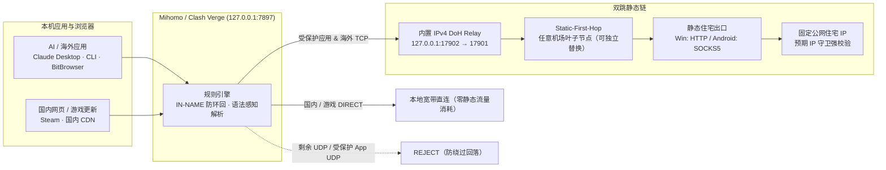

# Clash Chain Studio

<p align="center">
  <strong>所见即所得的链式代理（Chained Proxy）与 Claude / AI 独立环境防泄漏工作台</strong><br/>
  一套图形化本地工具，统一管理 <b>Windows / macOS / Linux (Clash Verge · Mihomo)</b> 与 <b>Android (Clash Meta)</b> 的第一跳订阅替换、静态住宅出口切换、规则分流与环境一致性体检。
</p>

<p align="center">
  <a href="LICENSE"></a>
  = 20" src="https://img.shields.io/badge/Node.js-%3E%3D20-2563eb.svg" />
  
  <a href="README_EN.md"></a>
</p>

---

## 为什么做这个项目？

用「国内中转机场（第一跳）+ 海外静态住宅 IP（末跳 `dialer-proxy`）」稳定使用 Claude / OpenAI 等海外 AI 服务时，痛点非常集中：

1. **换第一跳或换静态 IP 极易改坏规则**：手动改 `Script.js`、改端口、改 DNS、再手动同步手机两份 YAML，容易漏掉 `IN-NAME` 防环回、误伤游戏直连、或者在换机场后忘记更新新节点域名的 DNS 解析策略。
2. **桌面端与移动端配置不同步**：手机端既要日常普通浏览器国内直连（`Daily-Static-Chain`），又要特定场景下浏览器全流量走静链并提前拦截 UDP（`Claude-GoLogin-Static`），还要避开移动数据下的 DNS/TLS 35 握手故障。
3. **环境信号不一致导致风控**：IP 在美国达拉斯，但系统或 Claude Code 仍是北京时间、本地 DNS 泄漏、IPv6 旁路、UDP/WebRTC 绕过代理、或者切换静态 IP 时客户端未退出缓存了旧会话。

**Clash Chain Studio** 将整套工程经验沉淀为一个**零外部 npm 依赖、纯本地运行、凭据加密隔离**的图形化控制台。

---

## 整体架构



---

## 核心特性

- **🎨 图形化双车道拓扑画布（WYSIWYG）**
  - 一眼看清「蓝色静态链通道」与「绿色国内/游戏直连通道」；直接点击画布上的「第一跳」或「静态出口」滑出抽屉即刻替换。
  - 内置**实时路由模拟器**：点选 `Claude`、`ChatGPT`、`Google`、`游戏更新`、`百度`、`手机 Chrome`、`受保护 App UDP`，画布即时高亮真实走向。
- **✈️ 第一跳订阅独立替换 & 全链测速**
  - 支持远程订阅 URL、粘贴 Clash YAML / Base64 / `ss://` / `trojan://` / `vmess://`、或一键只读导入本机 Clash Verge 订阅。
  - 自动过滤套餐流量提示、`DIRECT`、嵌套 `dialer-proxy`、回环与重名节点，并**自动提取新订阅的所有节点域名写入 DNS `nameserver-policy`**。
  - 固定静态出口对所有第一跳逐个做两轮全链测速，测完强制恢复原选中节点。
- **🛡️ 静态出口独立维护 & 本地 AES-256-GCM 加密库**
  - 将「代理连接入口（Server）」「端口」「预期公网出口 IP」「地区/时区」「Windows/Android 协议」与加密凭据分开维护（完美支持入口网关 IP ≠ 公网出口 IP 的住宅代理供应商）。
  - 所有密码、订阅链接与临时 Controller 令牌仅加密存于本地 `data/vault.local.json`，界面预览与导出的诊断报表自动脱敏。
- **📱 手机 Clash Meta 可视化双配置与受控 ADB**
  - 同一订阅与静态出口一次生成 **`Daily-Static-Chain.yaml`（日常分流）** 与 **`Claude-GoLogin-Static.yaml`（浏览器全保护 + `127.0.0.1:17990` 专用口）**。
  - 内置手机模拟框，点 App 卡片即刻开关规则；默认采用移动数据稳态 DNS（`udp://127.0.0.1:7874` + 自动节点域名策略 + SOCKS5 `udp: false`）。
  - 严格区分「ADB 只读核对包名/双口探测」与「推送 YAML / 切换第一跳」，探测完自动清理临时转发映射。
- **🖥️ 通用桌面产物 & 内置一键 IPv4 Relay**
  - 同时生成 **Clash Verge `Script.js`**、**通用桌面独立 `Desktop-Static-Chain.yaml`**（适配 Mihomo Party / FlClash / macOS / Linux）、**手机双 YAML** 与 **`chain-runtime.json`**。
  - 画布顶栏支持一键启停内置 `StaticChainIPv4Relay.cjs`（解决部分代理对域名 CONNECT 的 TLS 35 握手问题），并随仓附带通用版静态 IP 启动守卫（`runtime/Start-ClaudeStaticGuard.cjs`）与多地区时区切换脚本（`runtime/Switch-RegionEnvironment.ps1`）。
- **🔍 5 维 Claude 独立环境与防泄漏体检中心**
  - 一键核验：双口 IP 一致性与 ASN 住宅画像、系统/CLI 时区语言对齐、Desktop `egressProxyUrl` 与 CLI `CLAUDE_CODE_PROXY_RESOLVES_HOSTS=1` 守卫、IPv6/UDP 防泄漏、切换前活跃进程残留。
  - 提供**保留登录态的白名单渲染缓存清理**（运行中自动禁止清理，绝不触碰 Cookie 与配置）及独立浏览器防风控 SOP。
- **🕒 原子写入、自动备份与一键回滚**
  - 覆盖 Clash Verge `profiles/Script.js` 前自动备份并做 SHA-256 回读校验，版本记录页支持一键秒级回滚。

---

## 快速开始

### 环境要求

- **Node.js >= 20**（零外部 npm 依赖，无需 `npm install`）
- **Python 3 + PyYAML**（用于高保真解析与往返校验任意第三方 Clash YAML 订阅：`pip install pyyaml`）
- 可选：`adb`（如需一键推送手机配置与 ADB 只读探测）

### 启动方式

- **Windows（推荐）**：直接双击 [`Start-ChainStudio.cmd`](Start-ChainStudio.cmd)（自动检测更新并重启旧服务，以独立应用窗口打开 `http://127.0.0.1:4328`）。
- **macOS / Linux / 命令行**：
  ```bash
  npm start
  # 浏览器访问 http://127.0.0.1:4328
  ```

### 标准使用流程

1. **导入现有配置**：首页点击 **「从本机导入」**（或导入您的第一跳订阅与静态住宅 IP）。
2. **核验出口**：点击右上角 **「测出口」**，确认静态出口 IP 与预期一致（若入口网关与公网 IP 不同，可在静态出口抽屉一键采纳实测公网 IP）。
3. **同步生成双端配置**：点击 **「生成并应用」**，按需勾选写入 Clash Verge `Script.js`，同时在 `output/<versionId>/` 下自动产出桌面与手机全部配置。
4. **手机导入**：切到 **「手机配置」** 页，通过 ADB 一键推送到手机 Download 或下载两份 YAML，在 Clash Meta for Android 中按需导入激活并只读验收。
5. **启动 Claude 前体检**：切到 **「环境体检」 → 「一键全面体检」**，确认 5 项全绿后再启动客户端。

---

## 开发与校验命令

```bash
npm test              # 运行全套单元与集成测试（规则引擎、双端生成、回滚、安全缓存、HTTP 脱敏）
npm run check:privacy # 运行隐私与敏感信息泄漏门禁（发布前必跑）
npm run check:syntax  # 校验前端与运行时脚本语法
npm run verify        # 一键执行全部门禁与测试
```

---

## 相关文档

- [技术架构与设计说明 (ARCHITECTURE.md)](ARCHITECTURE.md)
- [安全与隐私模型 (SECURITY.md)](SECURITY.md)
- [参与贡献指南 (CONTRIBUTING.md)](CONTRIBUTING.md)
- [更新日志 (CHANGELOG.md)](CHANGELOG.md)
- [English Documentation (README_EN.md)](README_EN.md)

## 免责声明

本项目为本地网络配置管理、链式代理拓扑可视化与环境一致性自检工具，不含任何代理节点、订阅链接或破解功能。请遵守所在地区法律法规及目标平台的服务条款，所有凭据与网络配置均由用户自行在本机管理。
